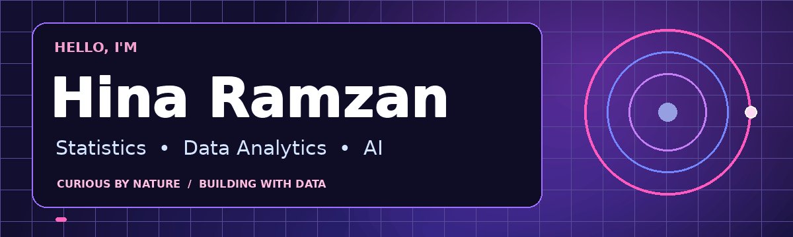

 

&nbsp;

&nbsp;

---

<table>
<tr>
<td width="30%" align="center" valign="middle">

 
✦ your friendly data buddy ✦
</td>
<td valign="middle">

### Hey, I'm Hina! 👋

**Statistics • Data Analytics • AI**

I enjoy exploring data, solving analytical problems, and experimenting with AI. My interests include statistical learning, machine learning, and making data easier to understand.

📍 Faisalabad, Pakistan

</td>
</tr>
</table>

## ✦ What I love working on

| 📊 Data & Statistics | 🤖 AI & Prompting | 🔎 Research |
|:---:|:---:|:---:|
| Analysis, visualization & modelling | AI training & prompt engineering | Missing-data imputation & ML |

## ⚡ Tech & tools

## 🚀 Live projects

| Project | Explore |
|:--|:--:|
| **NASA Space Apps Challenge** | [LIVE ↗](https://hr-pyro-vanta.vercel.app/) |
| **DataMind AI** | [LIVE ↗](https://datamind-ai-bendofu7gv2zaaujeaoepe.streamlit.app/) |
| **HypothesisX AI** | [LIVE ↗](https://hypothesisx-ai-hypothesis-agent.streamlit.app/) |

## 🌱 A little more

- 🎓 M.Phil. Statistics graduate
- 🧩 Interested in machine learning for incomplete datasets
- 🪄 Experience with AI training, prompt engineering, and data analysis
- 🤝 Happy to connect on research, analytics, and AI ideas

Thanks for stopping by — let's turn curiosity into insight. ✨

