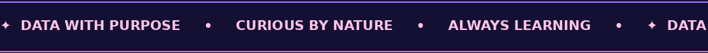

 

&nbsp;

&nbsp;

---

### Hey, I'm Hina! 👋

**Statistics · Data Analytics · AI**

I enjoy exploring data, solving analytical problems, and experimenting with AI.

## ✦ My interests

| 📊 Data & Statistics | ✨ AI & Prompting | 🔎 Research |
|:---:|:---:|:---:|
| Analysis · Visualization | AI workflows · Prompt design | Statistical learning · ML |

## ⚡ Tools I work with

## 🚀 Selected projects

| Project | Link |
|:--|:--:|
| **NASA Space Apps Challenge** | [Explore ↗](https://hr-pyro-vanta.vercel.app/) |
| **DataMind AI** | [Explore ↗](https://datamind-ai-bendofu7gv2zaaujeaoepe.streamlit.app/) |
| **HypothesisX AI** | [Explore ↗](https://hypothesisx-ai-hypothesis-agent.streamlit.app/) |

Thanks for visiting · Let's turn curiosity into insight ✨

