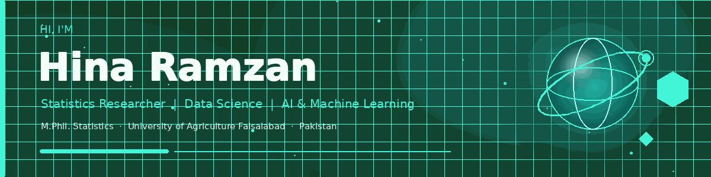

| **Statistics & Research** | **Data Science & ML** | **AI Learning Journey** |
|:---:|:---:|:---:|
| Missing data imputation | R · Python · SPSS | GenAI · RAG |
| Simulation studies | Data analysis & visualization | Agentic AI · Multi-agent systems |
| Statistical modeling | Research with real datasets | APIs · Streamlit · FastAPI |

**M.Phil. Statistics — University of Agriculture Faisalabad (2025)**  
I work at the intersection of statistical methods, machine learning and data quality, with a research focus on making incomplete datasets more useful and reliable.

- 🏅 **Talented Student Award** — Educational Youth Expo, Faisalabad | 2017
- 📍 **3rd International Conference on Recent Trends in Statistics** — NUST Islamabad | 2024
- 📍 **Data Handling Techniques for Applied Sciences** — University of Agriculture Faisalabad | 2024
- 📍 **Latest Data Analysis Tools of Mathematics and Statistics** — University of Agriculture Faisalabad | 2024

*Additional workshops: Analysis using Statistical Software; Data Visualization & Analysis with SPSS; E-Rozgaar Faisalabad Convention; Freelancing and Digital Marketing.*

| Project | Details | Live app |
|:---|:---|:---:|
| **M.Phil. Simulation Study** | Comparative analysis of advanced machine learning and traditional statistical methods for missing data imputation. | Research |
| **NASA Space Apps Challenge** | Project entry developed for NASA Space Apps Challenge 2026. | [LIVE APP](https://hr-pyro-vanta.vercel.app/) |
| **DataMind AI** | AI project prototype. | [LIVE APP](https://datamind-ai-bendofu7gv2zaaujeaoepe.streamlit.app/) |
| **HypothesisX AI** | AI hypothesis assistant prototype. | [LIVE APP](https://hypothesisx-ai-hypothesis-agent.streamlit.app/) |

🔹 Explore further projects in [my repositories](https://github.com/hina971?tab=repositories).

**Statistics & Data Analysis**

**Machine Learning & Research**

**GenAI & RAG — Learning Track**

**Code & APIs — Learning Track**

**Digital & Professional Skills**

- **M.Phil. thesis:** *Comparative Analysis of Advanced Machine Learning Techniques and Statistical Methods for Missing Data Imputation: A Simulation Study.*
- Designed simulation studies in **R and Python** to compare machine-learning approaches (including MissForest and deep learning) with traditional statistical methods.
- Evaluated imputation performance through **accuracy, bias and efficiency** under different missingness mechanisms.
- Research interests: missing data analytics, statistical learning, AI-assisted imputation and high-dimensional incomplete datasets.

<table>
<tr>
<td>

</td>
<td>

</td>
</tr>
</table>

*Stats and contribution activity are fetched from public GitHub profile services.*

**Email:** [hina199681@gmail.com](mailto:hina199681@gmail.com)  
**LinkedIn:** [linkedin.com/in/hina-ramzan-81536033a](https://www.linkedin.com/in/hina-ramzan-81536033a/)  
**GitHub:** [github.com/hina971](https://github.com/hina971)

---

STATISTICS · DATA SCIENCE · MACHINE LEARNING · GENERATIVE AI

